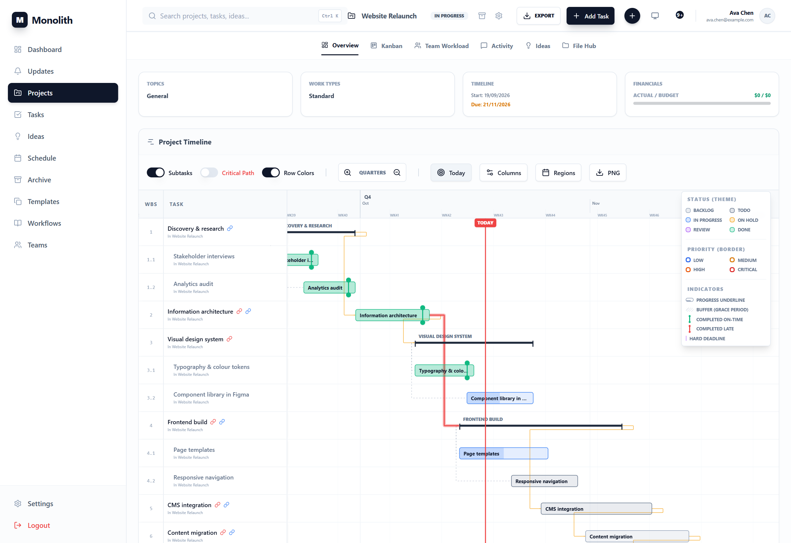
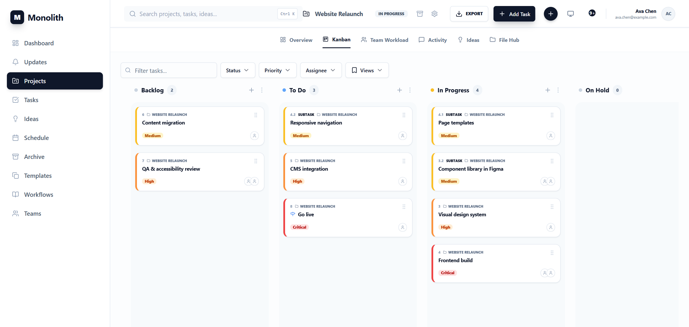
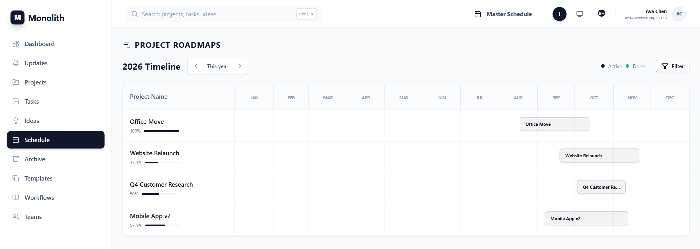
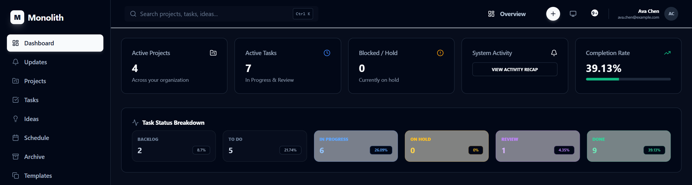

# 🗿 Monolith

[](https://www.docker.com/)
[](https://opensource.org/licenses/MIT)
[](https://fastapi.tiangolo.com/)
[](https://reactjs.org/)

**Monolith** is a high-performance, dockerized project management platform built for technical teams. It enforces a strict **Project → Task → Subtask** hierarchy and provides advanced high-density visualizations to turn complex roadmaps into actionable plans.

---



<table>
  <tr>
    <td width="50%"></td>
    <td width="50%"></td>
  </tr>
  <tr>
    <td colspan="2"></td>
  </tr>
</table>

## 🚀 Key Features

- **🎯 Strict Hierarchy:** Maintain absolute clarity with a 3-level structure. Subtask completion automatically drives Task progress, which in turn updates Project completion metrics.
- **📊 High-Density Visualizations:**
    - **Advanced Gantt:** Orthogonal stepped lines, dependency Z-shapes, and multi-level zoom (Day to Year).
    - **Smart Kanban:** Full status parity (Backlog to Done) with precise drag-and-drop reordering and a 5-task column limit.
    - **Activity Heatmap:** GitHub-style contribution tracking (Last 12 months rolling).
- **🤝 Decentralized Management:** Every user can create and manage their own teams, fostering organic collaboration.
- **💡 Universal Ideas Hub:** Centralized brainstorming engine with up/down voting, task-linking, and multi-path promotion (Task or Project).
- **📜 Professional Workflows:** Enhanced SOP library with full LaTeX math support and interactive "Tipsy" tooltips.
- **📥 Data Portability:** High-DPI Gantt PNGs, Project CSV, and Excel (.xlsx) exports for comprehensive reporting.
- **🤖 AI-Ready (MCP):** Integrated **Model Context Protocol** server allows AI agents to autonomously manage your projects, tasks, and subtasks.
- **🔐 Project Roles:** Viewer / editor / admin per project, enforced by the API. See [Project roles](docs/how-to/project-roles.md).
- **⚙️ Automations & Webhooks:** "When X happens, do Y" rules per project plus signed outgoing webhooks. See [Automations](docs/how-to/automations.md).
- **🔁 Recurring Tasks & Calendar Feed:** RRULE-based repeats and a private iCalendar (ICS) feed for Outlook, Google or Apple Calendar. See [Recurring tasks](docs/how-to/recurring-tasks-and-calendar-feed.md).
- **⏱️ Time Tracking & Custom Fields:** Log time against tasks and add typed custom fields per project. See [the API reference](docs/reference-time-and-custom-fields.md).
- **✉️ E-mail:** Bundled mail server with an outbox queue, password reset, address verification, assignment notifications, digests and an optional outbound relay. See [E-mail](docs/how-to/email.md).
- **⌨️ Fast Navigation:** Command palette (<kbd>Ctrl</kbd>+<kbd>K</kbd>), keyboard shortcuts, filters and saved views. See [Command palette](docs/how-to/command-palette-and-saved-views.md).
- **🔔 Notification Centre, Bulk Actions & Dark Mode:** An in-app inbox with real-time updates, multi-select edits on task lists, and a light / dark / system theme.
- **⚡ Technical Excellence:**
    - Manual sorting with `sort_index` (Up/Down).
    - Recursive dependency tracking and status propagation.
    - One database transaction per compound operation; schema changes via Alembic migrations.
    - Automated weekly email summaries for users, team owners, and project owners.
    - Rootless Podman (or Docker) stack: Nginx, FastAPI, React, PostgreSQL and a mail server.

---

## 🛠️ Tech Stack

- **Frontend:** React 19, TypeScript, Tailwind CSS, Shadcn/UI, Lucide Icons, TanStack Query.
- **Backend:** FastAPI, SQLAlchemy (Async), PostgreSQL, Alembic, PyJWT, Pandas (for exports).
- **Infrastructure:** Podman or Docker Compose, Nginx, docker-mailserver.
- **AI Integration:** Model Context Protocol (MCP).

---

## 🏁 Quick Start

### Prerequisites
- Podman (rootless) with `podman-compose` >= 1.2, or Docker with Compose. See [Run with Podman](docs/how-to/run-with-podman.md) for details.

### 1. Configure and launch the stack
```bash
cp .env.example .env            # fill in the secrets and the first admin (see comments in the file)
scripts/mail-bootstrap.sh       # one-time: TLS cert + mailbox for the internal mail server
podman-compose up -d --build    # or: docker compose up -d --build
```

### 2. Access the Application
- **Frontend:** [http://localhost:8080](http://localhost:8080) (change the port with `HTTP_PORT` in `.env`)
- **API Docs:** [http://localhost:8080/api/docs](http://localhost:8080/api/docs)
- **MCP Server:** `http://localhost:8080/mcp/sse` when `MCP_API_KEY` is set (send it as a Bearer token).

### 3. First sign-in
There are no default accounts. Sign in with `FIRST_SUPERUSER_EMAIL` / `FIRST_SUPERUSER_PASSWORD` from your `.env`, create further users from the admin
screen, then remove the password from `.env`. Public sign-up is disabled unless `ALLOW_SIGNUP=true`.

---

## 📚 Documentation

**Tutorial**
- [Getting Started Guide](docs/tutorials/getting-started.md)

**How-to guides**
- [Run with Podman (and the internal mail server)](docs/how-to/run-with-podman.md)
- [Administrator Guide](docs/how-to/admin-guide.md)
- [Project roles](docs/how-to/project-roles.md)
- [Automation rules and webhooks](docs/how-to/automations.md)
- [Recurring tasks and the calendar feed](docs/how-to/recurring-tasks-and-calendar-feed.md)
- [Command palette, shortcuts and saved views](docs/how-to/command-palette-and-saved-views.md)
- [E-mail](docs/how-to/email.md)
- [Database migrations (Alembic)](docs/how-to/database-migrations.md)
- [Transactions](docs/how-to/transactions.md)
- [MCP Connection Guide](docs/how-to/setup-mcp.md)

**Reference**
- [MCP tools](docs/reference/mcp-tools.md)
- [Time tracking and custom fields (API)](docs/reference-time-and-custom-fields.md)
- Interactive API docs at `/api/docs` on a running stack

**Explanation**
- [System Architecture](docs/explanation/architecture.md)
- [Hierarchy & Status Logic](docs/explanation/hierarchy-logic.md)
- [Gantt logic](docs/explanation/gantt-logic.md)

---

## 🤖 MCP Integration

Monolith comes with a standalone MCP container. You can connect your favorite AI agent (e.g., Claude, Gemini) to the MCP server to automate your workflow.

**Available MCP Tools:**
- `create_project`: Generate new projects with metadata.
- `create_task` / `create_subtask`: Build out hierarchies.
- `search_projects`: Find project IDs by name.
- `update_task_status`: Real-time progress updates.
- `delete_project`: Full lifecycle management.

---

## 📦 Project Structure

```text
Monolith/
├── backend/            # FastAPI application, models, Alembic migrations, tests
├── frontend/           # React application (Vite)
├── mcp/                # MCP Server entrypoint & Agent scripts
├── nginx/              # Reverse proxy configuration
├── scripts/            # mail-bootstrap.sh, live-smoke.sh
├── docs/               # Tutorials, how-tos, reference, explanation, screenshots
├── compose.yaml        # Full stack orchestration
└── compose.dev.yaml    # Dev overlay: hot reload, ports for db/backend/Vite
```

---

## 🧪 Tests and CI

```bash
# backend unit tests (no database needed); CI runs the explicit file list in ci.yml
cd backend && pip install -r requirements.txt pytest pytest-asyncio && python -m pytest -q tests/test_security_tier0.py
# frontend
cd frontend && npm ci && npm run typecheck && npm test && npm run build
# live checks against a running stack with a fresh database
scripts/live-smoke.sh
```

GitHub Actions ([`.github/workflows/ci.yml`](.github/workflows/ci.yml)) runs the backend unit tests and a `pip-audit` dependency scan,
the frontend typecheck, tests and build on Node 22, and then builds the full Podman stack and runs the live checks.

---

## 🤝 Contributing

We welcome contributions! Please see our documentation for internal conventions and component structures.

1. Fork the Project.
2. Create your Feature Branch (`git checkout -b feature/AmazingFeature`).
3. Commit your Changes (`git commit -m 'Add some AmazingFeature'`).
4. Push to the Branch (`git push origin feature/AmazingFeature`).
5. Open a Pull Request.

---

## 📄 License

Distributed under the MIT License. See `LICENSE` for more information.

---
*Created by the Monolith Team - 🌌 To the stars through projects.*
